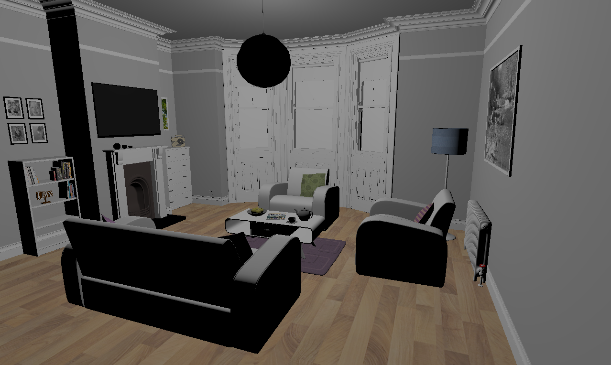

# RayTracing_Vulkan

A real-time path tracer written in C++ on Vulkan's hardware ray tracing pipeline. It renders a scene with Monte Carlo path tracing, reuses samples from earlier frames, and cleans up the remaining noise with an edge-avoiding À-Trous denoiser on a compute shader. Every shader exists in GLSL and Slang, and you can switch between them while the renderer runs.

## Features

### Rendering
- **Hardware ray tracing.** Uses [`VK_KHR_ray_tracing_pipeline`](https://docs.vulkan.org/refpages/latest/refpages/source/VK_KHR_ray_tracing_pipeline.html) and [`VK_KHR_acceleration_structure`](https://docs.vulkan.org/refpages/latest/refpages/source/VK_KHR_acceleration_structure.html), with a top-level and bottom-level acceleration structure built from the loaded model.
- **Monte Carlo path tracing.** One path per pixel per frame, up to a set maximum length. Russian roulette ends paths early without biasing the result.
- **GGX BRDF.** Uses the GGX microfacet distribution, from these two papers:
  - Walter et al., [Microfacet Models for Refraction through Rough Surfaces](https://www.cs.cornell.edu/~srm/publications/EGSR07-btdf.pdf) (EGSR 2007)
  - Heitz, [Sampling the GGX Distribution of Visible Normals](https://jcgt.org/published/0007/04/01/) (JCGT 2018)
- **Temporal history.** Each pixel is reprojected into the previous frame using the previous camera matrix, and its color is blended with the four surrounding history pixels by bilinear weight. A history pixel is only used if its normal and depth match the current pixel, so history doesn't leak across edges or through disocclusions. Each pixel keeps a running average with its sample count, and an optional cap on that count keeps the image responsive to changes.
- **À-Trous denoiser.** Based on Dammertz et al., [Edge-Avoiding À-Trous Wavelet Transform for fast Global Illumination Filtering](https://jo.dreggn.org/home/2010_atrous.pdf) (HPG 2010). Runs as a compute shader over several passes, with edge stops on depth, normal, albedo and colour. Lighting is divided by albedo before filtering and multiplied back afterwards, so textures stay sharp. Light sources are left out of the filter, and outlier pixels are clamped to their neighbours' range before the first pass.
- **Rasterizer.** A standard scanline renderer of the same scene, for comparison.
- **Post-processing.** Exposure and gamma, plus debug views for albedo, normals, depth and per-pixel sample count.
- **Window resizing.** The swapchain and every window-sized image, framebuffer and pipeline are rebuilt when the window changes size, and a minimized window pauses until it is restored.

### GLSL and Slang
- Every shader has a [Slang](https://shader-slang.org/) version alongside the GLSL original: path tracer, rasterizer, post-processing and denoiser.
- Both are compiled to SPIR-V at build time: GLSL to `spv/*.spv`, Slang to `spv/*.slang.spv`.
- Switch languages at runtime from the **Shaders** section of the settings panel, or start in Slang with `-slang`.
  - Switching rebuilds every pipeline and the shader binding table.
  - If a Slang binary is missing, the renderer falls back to the GLSL one.
- `shaders/shared_structs.h` is shared by C++, GLSL and Slang, so buffer and push-constant layouts are declared once.
  - Slang is compiled column-major, so glm matrices load unchanged.
  - GLSL's `M * v` is written `mul(M, v)` in Slang.

### Tools
- **Settings panel** (F1 to show or hide). Every path tracer, temporal history, denoiser, display and camera setting can be adjusted live, with buttons to reset history and restore defaults.
- **Performance window.** Opened from the settings panel. It shows:
  - FPS, frame latency and a frame-time graph.
  - Now/average/min/max timings over the last 240 frames, split into CPU work (input, camera and UI), draw work (acquire, record, submit and present), and time spent waiting for the GPU.

## Screenshots

| Rasterizer | Path tracing, no denoiser | Path tracing with denoiser |
|---|---|---|
|  |  |  |

### Denoiser: before and after the window fix

The emissive window panes used to leak into the walls around them, and the wide filter passes spread the brightest samples into square blotches. The denoiser now leaves light sources out of the filter, weights neighbours by colour as well as depth, normal and albedo, and clamps outlier pixels before the first pass.

| Before | After |
|---|---|
|  |  |
|  |  |

## Requirements

- Windows 10 or 11, 64-bit
- A GPU and driver that support Vulkan ray tracing ([`VK_KHR_ray_tracing_pipeline`](https://docs.vulkan.org/refpages/latest/refpages/source/VK_KHR_ray_tracing_pipeline.html) and [`VK_KHR_acceleration_structure`](https://docs.vulkan.org/refpages/latest/refpages/source/VK_KHR_acceleration_structure.html))
- [Vulkan SDK](https://vulkan.lunarg.com/) 1.4 or newer, with the `VULKAN_SDK` environment variable set. The SDK provides `glslangValidator` and `slangc`, which the build uses to compile shaders.
- Visual Studio with the C++ desktop workload. The project targets platform toolset v145 (Visual Studio 2026). For an older Visual Studio, change the toolset in the project properties.

GLFW, GLM, Dear ImGui, Assimp and stb_image are bundled in `libs/`.

### Development system

The renderer is developed and tested on this machine:

| Component | Spec |
|---|---|
| OS | Windows 11 Pro (build 26200) |
| CPU | Intel Core i7-13700K (16 cores, 24 threads) |
| RAM | 64 GB DDR5 |
| GPU | NVIDIA GeForce RTX 4060 Ti, 8 GB (driver 617.42) |
| IDE | Visual Studio Community 2026 (18.8.2) |
| Vulkan SDK | 1.4.335.0 (slangc 2025.23.2) |

At the default 1280×768 window, the path tracer with the denoiser runs at about 120 FPS on this system.

## Building and running

1. Open `vs/rtrt.sln` in Visual Studio.
2. Choose the `x64` platform and either the `Debug` or `Release` configuration, then build. The shaders are compiled to `src/spv/` as part of the build.
3. The build writes `rtrt.exe` to `vs/x64/<configuration>/`. Visual Studio starts it with `src/` as the working directory, so it can find `models/` and `spv/`. When starting it some other way, run it from `src/`.

Command-line options:

| Option | Effect |
|---|---|
| `-slang` | Start with the Slang shaders instead of GLSL |
| `-d` | Enable the Vulkan API dump layer |

## Controls

| Input | Action |
|---|---|
| Left-mouse drag | Look around |
| W / A / S / D | Move forward / left / back / right |
| E / C | Move up / down |
| F1 | Show or hide the settings panel |
| Esc | Quit |

## Coding guidelines

The C++ code follows the [Google C++ Style Guide](https://google.github.io/styleguide/cppguide.html), with these project exceptions:

- Code is indented with 4 spaces instead of 2, and `public:`/`private:` labels line up with the `class` keyword.
- Every opening brace goes on its own line (Allman style), including functions, classes and control statements.
- `if`, `else`, `for` and `while` always use braces, even around a single statement, and no block or function body is kept on one line.
- A statement that fits on one line stays on one line. If its trailing comment would push it past the limit, the comment goes on its own line above it.
- Lines can be up to 90 columns instead of 80.
- All names are PascalCase, including local variables, parameters, class members and struct fields. Members don't use an `m_` prefix or a trailing `_`.

Formatting is set in `.clang-format`. Format the code with the clang-format that comes with Visual Studio (`VC/Tools/Llvm/x64/bin/clang-format.exe`), or with clang-format 14 or newer. Third-party code in `libs/` and the generated `extensions_vk.*` files are excluded.
