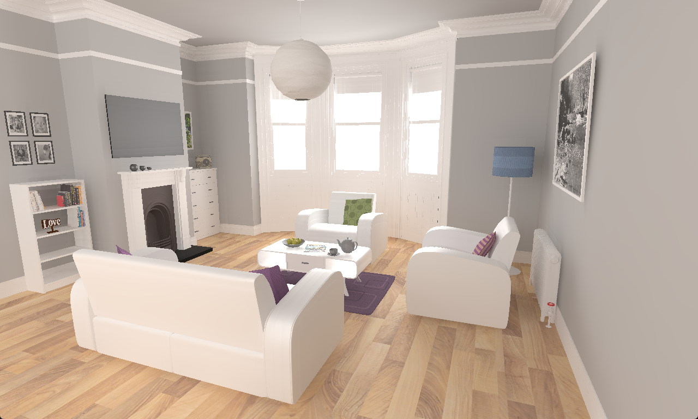
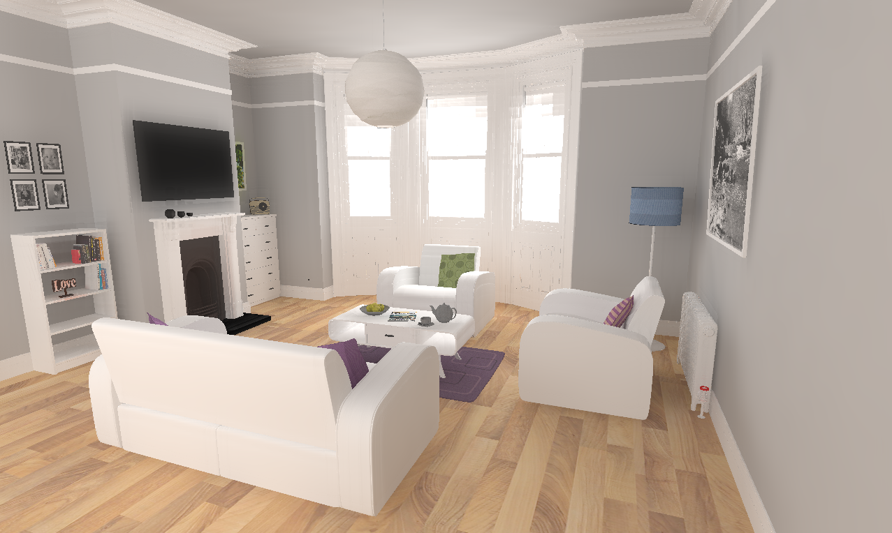
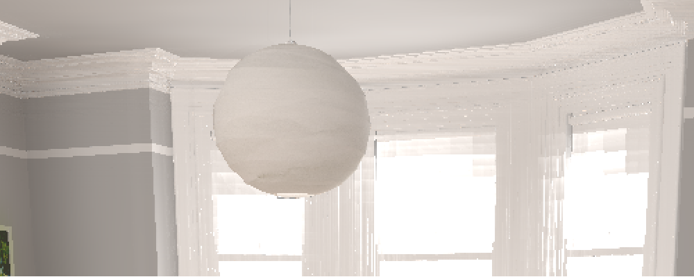
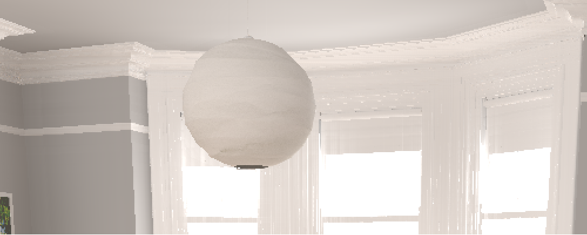

# RayTracing_Vulkan

A real-time path tracer written in C++ on Vulkan's hardware ray tracing pipeline. It renders a scene with Monte Carlo path tracing, reuses samples from earlier frames, and cleans up the remaining noise with an edge-avoiding À-Trous denoiser on a compute shader. The shaders are written in Slang, which also generates a GLSL version of each one; you can switch between the two while the renderer runs.



## Features

### Rendering
- **Hardware ray tracing.** Uses [`VK_KHR_ray_tracing_pipeline`](https://docs.vulkan.org/refpages/latest/refpages/source/VK_KHR_ray_tracing_pipeline.html) and [`VK_KHR_acceleration_structure`](https://docs.vulkan.org/refpages/latest/refpages/source/VK_KHR_acceleration_structure.html), with a top-level and bottom-level acceleration structure built from the loaded model.
- **Monte Carlo path tracing.** One path per pixel per frame, up to a set maximum length. Russian roulette ends paths early without biasing the result.
- **GGX BRDF.** Uses the GGX microfacet distribution, from these two papers:
  - Walter et al., [Microfacet Models for Refraction through Rough Surfaces](https://www.cs.cornell.edu/~srm/publications/EGSR07-btdf.pdf) (EGSR 2007)
  - Heitz, [Sampling the GGX Distribution of Visible Normals](https://jcgt.org/published/0007/04/01/) (JCGT 2018)
- **Temporal history.** Each pixel is reprojected into the previous frame using the previous camera matrix, and its color is blended with the four surrounding history pixels by bilinear weight. A history pixel is only used if its normal and depth match the current pixel, so history doesn't leak across edges or through disocclusions. Each pixel keeps a running average with its sample count, and an optional cap on that count keeps the image responsive to changes.
- **À-Trous denoiser.** Based on Dammertz et al., [Edge-Avoiding À-Trous Wavelet Transform for fast Global Illumination Filtering](https://jo.dreggn.org/home/2010_atrous.pdf) (HPG 2010). Runs as a compute shader over several passes, with edge stops on depth, normal, albedo and colour. Lighting is divided by albedo before filtering and multiplied back afterwards, so textures stay sharp. Light sources are left out of the filter, and outlier pixels are clamped to their neighbours' range before the first pass.
- **Rasterizer.** A standard scanline renderer of the same scene, for comparison.
- **Post-processing.** Exposure and gamma, plus debug views for albedo, normals, depth and per-pixel sample count.
- **Window resizing.** The swapchain and every window-sized image, framebuffer and pipeline are rebuilt when the window changes size, and a minimized window pauses until it is restored.

### Slang and generated GLSL
- Every shader is written once, in [Slang](https://shader-slang.org/): path tracer, rasterizer, post-processing and denoiser.
- Each entry point is compiled straight to SPIR-V, in `spv/*.slang.spv`. This is what the renderer uses by default.
- A GLSL version is generated only when you ask for it:
  - Pick **GLSL (generated)** in the **Supported shader types** section of the settings panel, then click **Build GLSL shaders**. The build runs in the background while the renderer keeps going, and the renderer switches to GLSL once it finishes.
  - Slang writes the GLSL to `shaders/glsl/`, where you can read it, and `glslangValidator` compiles it to `spv/*.spv`.
  - While GLSL is in use, **Rebuild GLSL shaders** regenerates it after a Slang change and reloads it.
  - Starting with `-glsl` builds the GLSL shaders first if they're missing.
- Switching between Slang and GLSL rebuilds every pipeline and the shader binding table.
- `shaders/shared_structs.h` is shared by C++ and Slang, so buffer and push-constant layouts are declared once.
  - Slang is compiled column-major, so glm matrices load unchanged.
  - Slang writes buffer pointers as `std430` in its GLSL output, while the C++ data is tightly packed. `compile_shaders.bat` switches them to `scalar`, the layout Slang's own SPIR-V uses.

### Tools
- **Settings panel** (F1 to show or hide). Every path tracer, temporal history, denoiser, display and camera setting can be adjusted live, with buttons to reset history and restore defaults.
- **Performance window.** Opened from the settings panel. It shows:
  - FPS, frame latency and a frame-time graph.
  - Now/average/min/max timings over the last 240 frames, split into CPU work (input, camera and UI), draw work (acquire, record, submit and present), and time spent waiting for the GPU.


## Screenshots

| Rasterizer | Path tracing, no denoiser | Path tracing with denoiser |
|---|---|---|
|  |  |  |

## Requirements

- Windows 10 or 11, 64-bit
- A GPU and driver that support Vulkan ray tracing ([`VK_KHR_ray_tracing_pipeline`](https://docs.vulkan.org/refpages/latest/refpages/source/VK_KHR_ray_tracing_pipeline.html) and [`VK_KHR_acceleration_structure`](https://docs.vulkan.org/refpages/latest/refpages/source/VK_KHR_acceleration_structure.html))
- [Vulkan SDK](https://vulkan.lunarg.com/) 1.4 or newer, with the `VULKAN_SDK` environment variable set. The SDK provides `glslangValidator` and `slangc`, which the build uses to compile shaders.
- Visual Studio 2022 or newer with the C++ desktop workload
- [CMake](https://cmake.org/) 3.20 or newer (Visual Studio's bundled CMake also works)

GLFW, GLM, Dear ImGui, Assimp and stb_image are bundled in `libs/`.

### Development system

The renderer is developed and tested on this machine:

| Component | Spec |
|---|---|
| OS | Windows 11 Pro (build 26200) |
| CPU | Intel Core i7-13700K (16 cores, 24 threads) |
| RAM | 64 GB DDR5 |
| GPU | NVIDIA GeForce RTX 4060 Ti, 8 GB (driver 617.42) |
| IDE | Visual Studio Community 2026 (18.8.2) |
| Vulkan SDK | 1.4.335.0 (slangc 2025.23.2) |

At the default 1280×768 window, the path tracer with the denoiser runs at about 120 FPS on this system.

## Building and running

The project is described by `CMakeLists.txt`. No Visual Studio files are kept in the repository.

1. Generate the Visual Studio solution in `build/` by running `scripts/generate_vs_files.bat` (double-click it, or pass `open` to also open the solution). It runs:
   ```bash
   cmake -S . -B build -A x64
   ```
2. Open `build/rtrt.slnx` (`build/rtrt.sln` with Visual Studio 2022) in Visual Studio or Rider and build `Debug` or `Release`, or build from the command line:
   ```bash
   cmake --build build --config Release
   ```
   The shaders are compiled to `src/spv/` as part of the build. Source files added under `src/` are picked up the next time CMake runs, which the build does on its own.
3. The build writes `rtrt.exe` to `build/<configuration>/`. Visual Studio and Rider start it with `src/` as the working directory, so it can find `models/` and `spv/`. When starting it some other way, run it from `src/`.

If the build picks up an old project or stale output, run `scripts/clean_project_files.bat` and then `scripts/generate_vs_files.bat`. The clean script deletes the generated solution, build output and compiled shaders (`build/`, `out/`, `vs/`, `.vs/`, `cmake-build-*/`, `src/spv/`, `src/shaders/glsl/`), leaving only the files in the repository plus your `imgui.ini` and screenshots.

You can also open the repository folder directly in Visual Studio (File > Open > Folder), which uses `CMakeLists.txt` without a solution.

The compiled shaders in `src/spv/` and the generated GLSL in `src/shaders/glsl/` aren't kept in the repository. If any Slang shaders are missing when `rtrt.exe` starts, it runs `scripts/compile_shaders.bat` to build them with the Vulkan SDK's `slangc`, then carries on. You can also run `compile_shaders.bat` yourself (from any folder) after editing a shader, `compile_shaders.bat raytrace.slang` to rebuild one file, or `compile_shaders.bat glsl` to also generate the GLSL versions (which uses `glslangValidator` too). It needs the `VULKAN_SDK` environment variable, which the SDK installer sets.

Command-line options:

| Option | Effect |
|---|---|
| `-glsl` | Start with the shaders built from Slang's generated GLSL, building them first if needed |
| `-d` | Enable the Vulkan API dump layer |

## Controls

| Input | Action |
|---|---|
| Left-mouse drag | Look around |
| W / A / S / D | Move forward / left / back / right |
| E / C | Move up / down |
| F1 | Show or hide the settings panel |
| Esc | Quit |

## Coding guidelines

The C++ code follows the [Google C++ Style Guide](https://google.github.io/styleguide/cppguide.html), with these project exceptions:

- Code is indented with 4 spaces instead of 2, and `public:`/`private:` labels line up with the `class` keyword.
- Every opening brace goes on its own line (Allman style), including functions, classes and control statements.
- `if`, `else`, `for` and `while` always use braces, even around a single statement, and no block or function body is kept on one line.
- A statement that fits on one line stays on one line. If its trailing comment would push it past the limit, the comment goes on its own line above it.
- Lines can be up to 90 columns instead of 80.
- All names are PascalCase, including local variables, parameters, class members and struct fields. Members don't use an `m_` prefix or a trailing `_`.

Formatting is set in `.clang-format`. Format the code with the clang-format that comes with Visual Studio (`VC/Tools/Llvm/x64/bin/clang-format.exe`), or with clang-format 14 or newer. Third-party code in `libs/` and the generated `extensions_vk.*` files are excluded.

## Changelog

### 2.4 Shader script in scripts/ and assimp.dll beside the exe ([ca5c863](https://github.com/zyoKo/RayTracing_Vulkan/commit/ca5c863c64a3f4b8e7a7feb95895a5a32c94c2c2))

`compile_shaders.bat` sat among the sources and a copy of `assimp.dll` was kept in `src/`. The script now lives in `scripts/` and runs from any folder, and the build copies `assimp.dll` next to `rtrt.exe` instead of into the repository.

### 2.3 Script for generating the Visual Studio solution ([3e39227](https://github.com/zyoKo/RayTracing_Vulkan/commit/3e392277ab09506c399750fdf9fe58b14c159840))

Generating the solution meant typing the CMake command by hand. `scripts/generate_vs_files.bat` now checks for CMake and the Vulkan SDK, generates the solution in `build/` and can open it, and the build steps name the `.slnx` file that Visual Studio 2026 uses.

### 2.2 CMake build in place of the Visual Studio project ([2414566](https://github.com/zyoKo/RayTracing_Vulkan/commit/24145669a125c690eac9e70dc2d816420ea9e133))

The Visual Studio solution and project files had to be kept in the repository and edited for every new source file. A `CMakeLists.txt` now builds the app and its Slang shaders and generates the solution locally in `build/`, so the `vs/` files are no longer tracked.

### 2.1 GLSL shaders built on request ([c2d7368](https://github.com/zyoKo/RayTracing_Vulkan/commit/c2d7368ab42e122535607695c693fe9105e78e22))

The builds and the startup check now compile only the Slang shaders. The GLSL versions are generated when asked for: from the **Build GLSL shaders** button in the new **Supported shader types** section of the settings panel (which switches to GLSL once the build finishes), by starting with `-glsl`, or with `compile_shaders.bat glsl`.

### 2.0 Slang as the only shader source ([a2a6b92](https://github.com/zyoKo/RayTracing_Vulkan/commit/a2a6b92d0b869668fe6e4843fc82d3ce954052a1))

The hand-written GLSL shaders are gone, so a fix only has to be made once, in Slang. Slang is now the default, and `compile_shaders.bat` generates a GLSL version of every shader in `src/shaders/glsl/` and compiles it for the `-glsl` mode.

### 1.1 Shaders compiled on first run ([8a1f3e4](https://github.com/zyoKo/RayTracing_Vulkan/commit/8a1f3e491f193cf058f76e618ba52ee504f5b3b7))

The compiled SPIR-V files are no longer stored in the repository. `rtrt.exe` checks `src/spv/` when it starts and runs `src/compile_shaders.bat` to build any that are missing.

### 1.0 Denoiser fix around emissive windows ([4f1e4f4](https://github.com/zyoKo/RayTracing_Vulkan/commit/4f1e4f4f785beb294b390b7b4065ccba910e563c))

The emissive window panes used to leak into the walls around them, and the wide filter passes spread the brightest samples into square blotches. The denoiser now leaves light sources out of the filter, weights neighbours by colour as well as depth, normal and albedo, and clamps outlier pixels before the first pass.

| Before | After |
|---|---|
|  |  |
|  |  |
